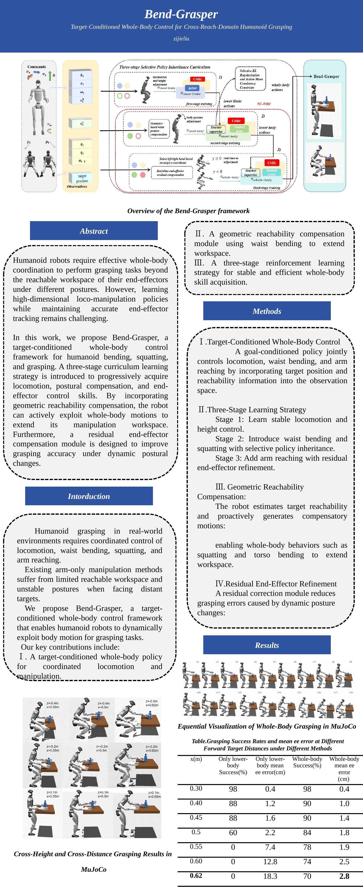
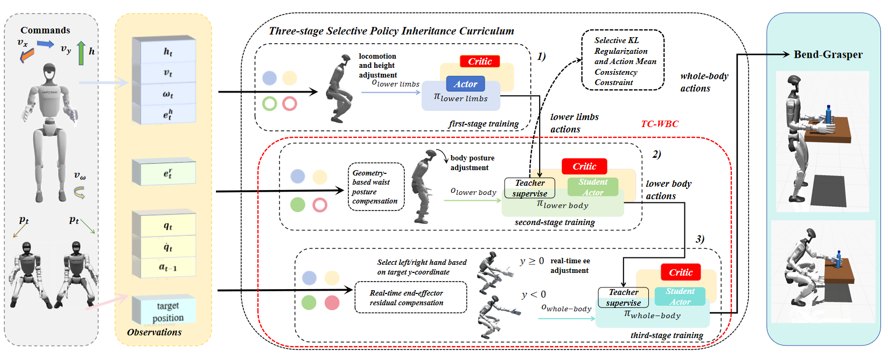
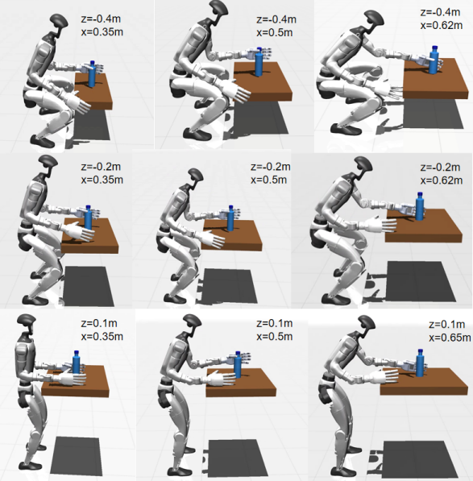
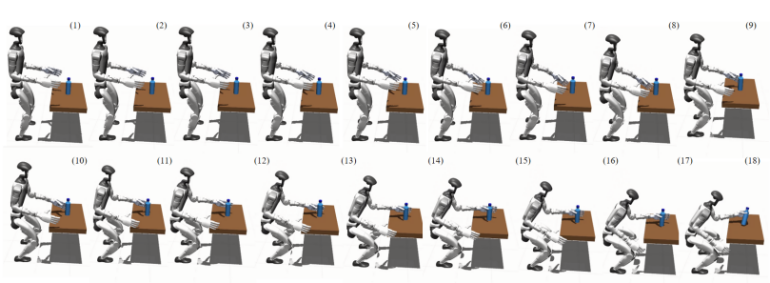

<br>
<p align="center">
<h1 align="center"><strong>Bend-Grasper</strong></h1>
<h3 align="center">Target-Conditioned Whole-Body Control for Cross-Reach-Domain Humanoid Grasping</h3>
  <p align="center">
    zijieliu
  </p>
</p>

<div id="top" align="center">

<!-- badges: add links when paper / project page are public -->
<!-- [](https://arxiv.org/abs/) -->



</div>

## 🏠 About

Humanoid robots need whole-body coordination to grasp targets beyond the arm’s reachable workspace under different postures. Learning high-dimensional loco-manipulation policies while keeping accurate end-effector tracking remains challenging.

**Bend-Grasper** is a target-conditioned whole-body control framework for humanoid **bending, squatting, and grasping**. A three-stage curriculum progressively learns locomotion, postural compensation, and end-effector control. With geometric reachability compensation, the robot actively uses whole-body motion to extend its manipulation workspace; a residual end-effector module improves grasp accuracy under dynamic posture changes.



<p align="center"><em>Overview of the Bend-Grasper framework</em></p>

### Key contributions

1. **Target-conditioned whole-body policy** — jointly controls locomotion, waist bending, and arm reaching with target position and reachability in the observation.
2. **Geometric reachability compensation** — estimates whether the target is reachable and drives compensatory squat / torso bend to extend the workspace.
3. **Three-stage RL curriculum** with selective policy inheritance (selective KL + action-mean consistency) for stable skill acquisition.

### Three-stage learning

| Stage | Focus | Policy |
|:-----:|-------|--------|
| **1** | Stable locomotion & height / squat tracking | Lower-limb actor |
| **2** | Waist bending + geometric reachability compensation; selective inheritance from stage 1 | Lower-body (legs + waist) student |
| **3** | Arm reaching + residual end-effector refinement | Whole-body student |

This codebase builds on [OpenHomie / HOMIE](https://github.com/InternRobotics/OpenHomie) (loco-manipulation + isomorphic exoskeleton cockpit) and extends it toward bend-grasp whole-body control in MuJoCo ([mjlab](https://github.com/mujocolab/mjlab)).

## 📊 Results

Cross-height / cross-distance grasping and sequential whole-body grasp rollouts in MuJoCo:

<p align="center">
  
  &nbsp;
  
</p>

<p align="center"><em>Left: grasping across height \(z\) and distance \(x\). Right: sequential whole-body grasping.</em></p>

Compared with lower-body-only control, whole-body Bend-Grasper keeps higher success and lower mean end-effector error as target distance grows (e.g. at \(x=0.62\,\mathrm{m}\): lower-body ≈ 0% success vs whole-body ≈ 70%).

## 📋 Repository layout

| Path | Description |
|------|-------------|
| [`HomieRL_mjlab/`](./HomieRL_mjlab) | **Primary training stack** — HOMIE-style G1 on mjlab (MuJoCo Warp), phase-1 / phase-2 (waist) curriculum, HIM-PPO |
| [`HomieRL/`](./HomieRL) | Original IsaacGym HOMIE training (legacy) |
| [`HomieDeploy/`](./HomieDeploy) | PC + Unitree G1 deployment |
| [`HomieHardware/`](./HomieHardware) | Exoskeleton / glove / pedal hardware resources |
| [`homie_ros_sim2sim/`](./homie_ros_sim2sim) | ROS sim2sim bridge |
| [`MujocoDeploy/`](./MujocoDeploy) | MuJoCo deployment helpers |

Each sub-directory has its own README for install and run details.

## 📚 Quick start (mjlab)

```bash
git clone https://github.com/flushddd/homie.git
cd homie/HomieRL_mjlab
uv sync
```

**Train** (Cursor / VS Code: Run and Debug → phase configs, or):

```bash
./scripts/launch_train.sh
./scripts/launch_tensorboard.sh   # http://localhost:6007
```

**Play:**

```bash
uv run play Mjlab-Homie-Flat-Unitree-G1-Phase2 \
  --num-envs 1 --viewer viser \
  --checkpoint-file logs/rsl_rl/homie_g1/<run>/model_*.pt
```

See [`HomieRL_mjlab/README.md`](./HomieRL_mjlab/README.md) for phase-1 / phase-2 resume, teacher lock, and environment notes.

## 🔗 Citation

If you use this work, please cite Bend-Grasper (bibtex TBD) and the upstream HOMIE paper:

```bibtex
@article{ben2025homie,
  title={HOMIE: Humanoid Loco-Manipulation with Isomorphic Exoskeleton Cockpit},
  author={Ben, Qingwei and Jia, Feiyu and Zeng, Jia and Dong, Junting and Lin, Dahua and Pang, Jiangmiao},
  journal={arXiv preprint arXiv:2502.13013},
  year={2025}
}
```

## 📄 License

Code inherited from HOMIE remains under the [CC BY-NC-SA 4.0](http://creativecommons.org/licenses/by-nc-sa/4.0/) license. Commercial use is not allowed without permission from the respective authors.

## 👏 Acknowledgements

- [HOMIE / OpenHomie](https://github.com/InternRobotics/OpenHomie) — loco-manipulation cockpit and RL codebase
- [mjlab](https://github.com/mujocolab/mjlab) — MuJoCo Warp training environment
- [RSL_RL](https://github.com/leggedrobotics/rsl_rl) / [HIMLoco](https://github.com/OpenRobotLab/HIMLoco) — on-policy RL & HIM estimator
- [Unitree](https://www.unitree.com/) G1 assets and SDK
